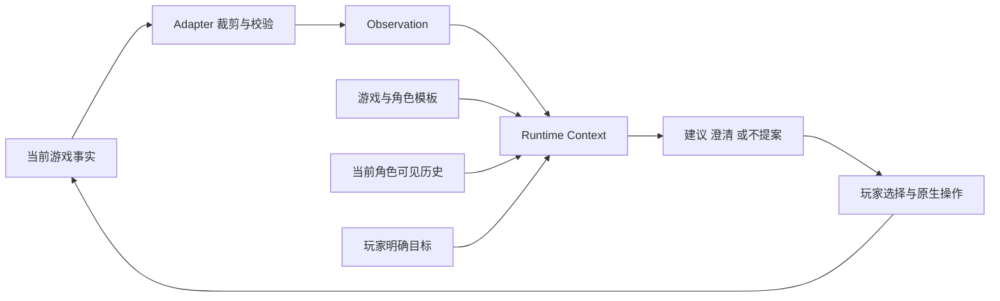

# World Is Agent Phase11.15 全量角色体验与情境化目标协作技术方案

状态：基础功能已进入后台验收。内容、原生 API 与自动化检查分别记录于 [验收记录](phase11.15-acceptance.md)；真实模型与实机结论独立记录。

当前源码为 Runtime `0.2.0`、Stardew Adapter `0.1.2`、Protocol `v1alpha2`。共用 Game Definition 与 34 名普通 NPC 内容使用 `stardew-content-v1`；游戏事实来源、角色清单与选定事件见 [游戏事实与角色覆盖](phase11.15-game-facts.md)。现有赴约恢复继续按 [11.1 验收条件](phase11.1-acceptance.md) 验证。

## 1. 产品目标

玩家能够感到 NPC 理解自己当前正在做的事，记得有依据的共同经历，并从角色自身立场提供有用、合适的回应。交互价值体现为：

- 初期遇到困惑时，能在游戏内向合适的人询问与当前进度相符的建议。
- 日常交往中，真实行为和表达过的想法能够被相关 NPC 承接，亲疏与个人经历影响后续交流。
- 世界、关系和角色生活发生变化时，回应随事实变化，各角色保留自己的立场和知识范围。
- 玩家已有目标时，NPC 可以帮助澄清目标、讨论做法并承接真实结果；适合提出新委托的场景通过独立试验判断。

任务文本数量、对话长度、委托生成率不作为体验达标依据。兴趣是否成立由玩家的实际选择和游玩反馈判断。

### 1.1 交付范围

| 工作单元 | 范围 | 完成依据 |
| --- | --- | --- |
| 全量角色内容 | 原版角色清单、公共世界知识、独立人设与中文声音 | 名单与入口覆盖、事实核对、逐角色内容检查 |
| 进度与经历事实 | 当前关系、选定世界变化、相关角色事件和有依据的交往事实 | 游戏侧来源、知识范围、时效与回档行为 |
| 情境化目标建议 | 玩家明确目标或主动共享的原生任务，与适合的 NPC 讨论 | 目标相关、角色合理、阶段可行、有实际帮助 |
| 受控试点 | 一种已有原生目标的协作闭环，技术候选为 Willy 相关钓鱼委托 | 身份与结果可验证，真实游玩证明协作有价值 |
| 新委托扩展 | 在质量与兴趣门槛通过后评估一种受限任务类型 | 独立的执行契约、玩家接取、完成证据和游戏侧规则 |

11.15 不承担账号、WIA Key、模型 Key 托管、远程接入或部署，相关工作按 [11.2 方案](phase11.2-hosted-runtime-and-launch.md) 执行。本方案不引入自主目标生成、无人监督的 NPC 日常规划、通用剧情导演或无限任务生成。

## 2. 内容、实例与事实

| 数据 | 范围与权威来源 | 用途 |
| --- | --- | --- |
| Game Definition | Runtime；按 `game_id` 共用 | 公共背景、世界规则、知识边界 |
| NPC Definition | Runtime；`game_id + definition_id` | 稳定身份、人物关系、性格、中文表达与帮助领域 |
| NPC 实例 | `game_id + world_id + entity_id` | 当前存档里的具体角色身份 |
| 当前状态 | Adapter 从游戏读取 Observation | 位置、日程、关系、进度与当前目标状态 |
| 历史与目标来源 | 当前角色可见的历史、玩家本轮输入或已核验原生任务 | 已发生经历、明确目标与讨论依据 |
| 实际执行与结果 | 游戏与 Adapter | 任务进度、完成、失败、取消及原生奖励 |

Runtime Core 继续保持 game-agnostic。角色模板和 prompt 在主仓库，游戏 API 读取、知识可见范围裁剪、原生目标解释与动作校验在 Adapter。Protocol 继续传输 namespaced Observation、通用事件与能力契约，不添加 Stardew 专有核心字段。

同名 NPC 在不同世界共用模板，但获得各自的 Observation 与 Memory。好感由游戏保存，玩家的个人目标不写进共享 definition。当前存档命名空间与未来托管账号归属分别处理。



## 3. 全量 NPC 与 Game Definition

角色清单与字段规范沿用 [NPC 与世界设定方案](npc-and-world-definitions-plan.md)。现有 33 份文件须与支持版本的原版名单核对并补齐 Leo；普通可建立好感关系的 34 名角色逐一检查。特殊 NPC 同时登记实际实体 ID、出现条件和交互入口，已有资料不能代替入口验证。扩展 Mod 角色另按对应版本纳入。

每个角色的内容包括：

1. 经核验的身份、稳定关系与生活背景。
2. 性格如何影响选择、表达和拒绝，保留角色的差异与界限。
3. 中文句式、语气和少量原创表达示例。
4. 兴趣、专业领域以及适合向该角色询问的事情。
5. 对亲疏、关系身份、世界变化和个人事件的条件表达。
6. 对未知事实、未见剧情、未实现能力和失败结果的处理。

Game Definition 覆盖公共地点、生活与建设规则、不同进度线及公共人物关系。角色私事、完整剧情、全部物品百科和整份配方表不作为全员共用背景注入。模板不授予 NPC 亲历某事件或知道玩家私事的资格。

首版沿用 definition `v1alpha1` 和现有字段，将帮助领域写入现有角色内容；不为这项内容更新增加通用人格 DSL。单轮只加载当前 NPC 与共用 Game Definition，合计目标不超过 4096 个现有估算 tokens。

## 4. 进度与行为事实

### 4.1 按实际进度组合判断

| 维度 | 首批事实 | 使用方式 |
| --- | --- | --- |
| 关系 | 当前好感、婚姻与室友信息；补充精确关系身份 | 调整亲疏与称呼，高好感不推导恋爱 |
| 世界 | 社区中心、Joja 会员、公交、矿车、温室 | 区分未完成、待生效、可用和未知 |
| 角色 | 当前角色出现、位置、相关关键事件 | 限制共同经历与剧情承接，不推导玩家选项 |
| 交往 | 玩家对当前 NPC 明确说过的话；试点所需的实际目标结果 | 只承接有来源、属于当前角色可见范围的信息 |
| 玩家目标 | 本轮明确目标，或当前 NPC 有依据知道的原生任务 | 决定是否需要建议、澄清或保持普通交流 |

年份、心数和游玩时长均不单独决定玩家处于哪个阶段。已有设施不代表玩家愿意参加相关活动，任务可做也不代表玩家对它有兴趣。

### 4.2 读取与知识范围

- 复用每轮 Observe，不增加全角色后台轮询或每个游戏时刻的模型调用。
- 游戏事实在主线程构建；读取失败的字段为未知，不能默认成未完成或尚未认识。
- 当前玩家的任务日志只向相关 NPC 提供必要条目：NPC 本身关联该任务，或玩家已在当前交互中明确共享；不能因能读取任务日志就让全体居民知道。
- 首个原生目标试点只读取当前 NPC 关联的任务。玩家谈及其它 NPC 的目标时，仅使用其主动说出的内容，不据此开放对其它任务日志的读取。
- 公开世界变化、玩家私事与角色亲历分别处理。知识范围由 Adapter 在投影前裁剪，模型说明不能代替裁剪。
- 不上传完整存档、全量邮件、事件脚本、全部任务或背包；物品与资源事实只在具体建议确实需要时读取有界部分。
- 玩家输入保留来源属性，作为目标与表达偏好的依据，不能覆盖系统规则、能力限制或当前游戏事实。
- 送礼、建造、采集等新行为来源只按当前工作单元需要接入。没有对应可信事件时，不把模型推测写成游戏事实。
- 读档后重新获取当前事实；当前关系与进度优先于历史。原生任务从列表消失本身不证明完成，也可能是取消、回档或不可见。

### 4.3 目标观察的拟定数据边界

在 `Observation.state.stardew` 下扩充可选字段。精确关系、世界进度、角色事件沿用内容方案的字段约定。目标试点仅增加当前交互所需的 `objective_context`：

| 信息 | 约束 |
| --- | --- |
| 原生目标引用 | 由 Adapter 产生，绑定当前世界、玩家和实际任务实例；模型不得自造 |
| 当前目标摘要 | 来自游戏或玩家明确输入，标记来源，限制长度 |
| 状态与进度 | 使用游戏可验证值，缺失或不明确为未知 |
| 已确认约束 | 当前季节、相关地点可达性、原生期限与完成规则 |
| 知识依据 | 当前 NPC 关联、玩家主动共享等可核查来源 |

目标引用、摘要、状态和约束由同一次游戏快照生成。先支持一个相关原生目标，摘要不超过 256 个字符，新增目标上下文不超过 512 个估算 tokens；预算不足时保留身份与已知状态，其余显式省略。Runtime 不解析该私有结构来决定游戏规则。

## 5. 何时值得提出建议或委托

### 5.1 先识别玩家的需要

首版只在玩家明确询问下一步、请求帮助、主动讨论目标或委托时形成目标建议。普通闲聊不自动附加任务。没有明确目标时可以询问一句，也可以继续原有话题。

目标依据可以是本轮明确输入，或玩家已经选择且主动讨论的原生任务。一次送礼、某件物品或一次闲聊不能被直接当成长期兴趣；静态 NPC 偏好也不是玩家偏好。

### 5.2 提案成立的五个条件

| 条件 | 应能回答的问题 | 不满足时 |
| --- | --- | --- |
| 目标相关 | 这件事与玩家现在明确想做的事有什么关系？ | 询问目标或不提案 |
| 角色合理 | 这个 NPC 为什么关心、了解或愿意帮助？ | 换成适合当前角色的回应，不冒充他人的专业 |
| 进度可行 | 所需地点、季节、资源与前置条件是否已知并可满足？ | 只问必要信息，或不给出具体承诺 |
| 价值明确 | 玩家能得到信息、技能练习、目标推进或关系体验中的哪一种具体帮助？ | 不用增加数量或奖励包装重复劳动 |
| 玩家有选择 | 玩家能否拒绝、讨论做法、表达精力限制，并知道真实限制？ | 保留正常交流，不强迫进入任务 |

事实可行性由游戏侧验证，角色与表达合理性由内容评审和场景评估检查。玩家兴趣由真实使用判断，不设一个加权“趣味分”代替结论，也不由模型自己宣布提案值得接受。

### 5.3 允许不提案

以下场景应停止或保留普通交流：玩家没有相关目标；刚明确拒绝且未重新请求；正在完成更紧急目标；前置状态未知；内容只是在换一种说法要求重复收集；NPC 缺乏合理动机；当前没有可验证的完成方式。

每个回合最多提出一个具体方向。玩家拒绝后正常承接，不扣游戏好感、不改变原生剧情、不用持续追问促成接取。首版不增加后台主动派单、周期催促或保证任务产出量的机制。

### 5.4 协商的真实边界

| 可以讨论 | 必须保持明确的限制 |
| --- | --- |
| 玩家偏好的玩法、准备顺序、行动方式、可投入的时间与精力 | 建议不代表任务规则已经修改 |
| 原生任务的完成策略与玩家是否继续尝试 | 原生目标、截止时间和奖励按游戏规则执行 |
| 新 WIA 委托在已实现范围内的可选参数 | 只有未来提供了校验与提交能力，才能承诺修改目标、期限或奖励 |

例如，玩家说不想赶时间，NPC 可以帮助调整行动计划或建议放弃这项限时原生任务；不能说已经替玩家延长原生期限。

### 5.5 场景判定示例

| 当前场景 | 合适的回应 |
| --- | --- |
| 玩家主动向 Willy 讨论已接取的钓鱼任务，相关进度和地点已知 | 围绕原生目标提供一个具体策略，并允许讨论做法与投入精力 |
| 玩家表示今天只想放松，没有目标请求 | 保持普通交流或提供轻量建议，不附加任务 |
| 玩家请求的活动依赖尚未确认的地区或条件 | 先问必要信息；无法确认时不提出具体完成承诺 |
| 玩家已经说明相似收集活动很重复 | 改变帮助方式或不提案，不靠提高数量制造新任务 |
| 角色缺乏相关专业与亲历依据 | 保持角色自身的看法与知识范围，不能为提供答案而变成全知角色 |

## 6. 受控试点与进入条件

### 6.1 先做提案评审

使用真实目标或经过标注的场景快照，评估模型选择“澄清、建议、不提案”的能力，不写入游戏任务。记录目标来源、NPC、支持事实、建议内容、缺失信息与玩家反馈即可；使用文件记录，不建设独立推荐平台或评测服务。

至少覆盖 24 个对照场景，分为六组：明确目标、进度前后、NPC 差异、偏好与协商、不应提案、结果不确定。进度或 NPC 改变时，检查建议是否合理变化；没有依据时不要求模型强行产出。

进入游戏试点前，要求所有硬前置与引用检查通过；不应提案场景没有错误承诺；每个有效建议能说明具体帮助。文本评审只证明提案值得试用，不证明玩法有趣。

### 6.2 首个技术候选

候选为玩家已经接取、且愿意向 Willy 讨论的原生钓鱼委托。玩家先有目标，NPC 提供当前条件下的建议、有限协商与后续承接。游戏负责原生任务进度、完成、取消、期限和既有奖励。

原生交互使用游戏的任务探测接口分流：手持物品时保留交付或送礼；空手且原生任务可以通过 NPC 对话推进时保留原生处理。探测仅使用 `probe: true`，正式交付由游戏执行一次。其它交互沿用现有 AI 对话；不新增物品拖拽窗口。

实例标识写入原生 Quest 的 `modData`，最近观察到的目标状态写入当前玩家的 `modData`，关联当前世界与玩家。只有原生完成标记支持 completed；任务消失为 unavailable，不从背包变化、玩家自报或列表差异推导成功。读档重建观察，游戏保存负责这些关联与结果的分支归属。

这个候选需要先完成 Adapter 技术验证：实际任务实例能否稳定识别、当前状态能否读取、完成与取消能否区分、保存读档与重复事件能否保持一致。无法取得可靠证据时，保持建议模式，不宣称任务协作闭环已完成；不因此扩建通用任务引擎。

试点先支持单人、一个 NPC、一种原生目标。NPC 内容仍按全量交付；目标玩法只扩大到通过验证的类型。

### 6.3 试点交互

```text
玩家主动讨论已有目标
  → Adapter 提供相关目标及当前事实
  → 模型回应、澄清或提供一个建议
  → 玩家讨论做法、继续尝试或拒绝建议
  → 玩家按原生玩法行动
  → Adapter 获取可信的进度或结果
  → 后续交互承接实际结果与已记录的共同讨论
```

试点复用当前中文对话入口。继续对话时保持现有三个玩家回复选项与自由输入，结束时沿用现有结束形式。选项可以表达采用建议、调整做法、暂时不做；它们不是模型自动改动原生任务的授权。无新增网页、任务广场或委托管理后台。

### 6.4 新委托的进入条件

仅在真实试玩证明目标协作有价值、且技术候选具备稳定身份和结果后，选择一种新委托类型补充开发契约。必须先写清：角色动机、允许的目标参数、玩家接取动作、完成条件、取消方式、期限语义、保存读档、幂等及奖励规则。

新增委托的目标只从已核验的有限类型中形成。模型负责理解、协商与角色表达，游戏侧确定条件是否合法、结果是否成立、奖励是否可发。物品、金币、好感等奖励副作用需要独立界定范围，不能从本方案直接推导为已授权能力。

本轮基础交付不以新委托引擎为前提。提案缺乏兴趣或技术验证不成立时，保留全量角色、事实与有用建议，停止扩展该任务类型。

## 7. 持久化、结果与恢复

### 7.1 首版数据归属

- 原生任务状态与奖励由游戏存档保存，Runtime 不建立另一份原生进度权威。
- 玩家告诉当前 NPC 的目标与讨论进入现有历史；只记录实际发生的交流，不抽取为永久人格或全局偏好。
- 实际结果只有可信游戏事实才能支持。模型总结、玩家口头自报、任务消失或超时猜测均不能直接变成完成证据。
- 跨进程恢复不恢复同一个模型调用。新的交互重新 Observe，再根据当前事实和可见历史继续。
- 原生任务日志仍显示原生任务。11.1 Web 预约视图继续展示现有 Task，不将目标讨论伪装成已经持久化的预约或委托。

现有 `TaskSpec`、游戏时钟 wake、证据与 checkpoint 提供可参考的生命周期机制，但不能仅因 SQLite 已能存储任务，就把原生委托直接塞进预约契约。首个原生目标协作试点不修改 Task schema 或既有预约语义。

实现边界参考现有 [TaskSpec 与证据模型](../../runtime/internal/task/model.go)、[Task 上下文与来源校验](../../runtime/internal/agent/task_context.go) 和 [历史权威顺序](../../runtime/internal/context/history_projection.go)。

### 7.2 Adapter 验证清单

| 问题 | 必须满足的行为 |
| --- | --- |
| 原生任务 ID 被复用或缺失 | 核对任务实例，而不只比较类型或名称；不能确认时返回未知 |
| 任务完成后从日志移除 | 从经验证的完成来源取得结果，不能通过“消失”推导成功 |
| 重复事实或重复 Observe | 同一事实不重复写入新的成功经历；沿用事件去重与来源关联边界 |
| 存档回退 | 当前任务与结果按当前存档重新验证，未来历史不能覆盖当前事实 |
| 中断或缺少证据 | 如实表示状态未确认，不重复发放奖励，也不伪造失败原因 |
| 同名 NPC 或相同任务跨世界 | 世界、角色和当前玩家归属分别校验 |

如需新的完成事件读取、游戏存档内关联记录或去重标识，只为这一种试点定义最小实现，在 Adapter 技术验证中确认保存与回档语义。没有验证通过前，不承诺新增的跨重启结果记忆。

通用 Memory 目前仍缺少完整废弃分支隔离。测试中如果只能看到旧历史而无法确认其对应当前分支，不把它渲染成当前任务已完成。11.15 不宣称通过内容规则解决了 Memory 分支存储问题。

## 8. 技术修改范围与预算

| 位置 | 修改内容 |
| --- | --- |
| 主仓库 Game Profile 与 definitions | 全量角色、公共背景、阶段表达、帮助领域及未知语义 |
| 主仓库 definition / Context / 配置测试 | 清单、加载、当前角色隔离、预算、已有配置保留与完整请求 |
| Adapter Observation Builder / Model / Factory / Mapper | 有界的关系、进度、事件与相关原生目标事实 |
| Adapter 试点读取与事件入口 | 一种原生目标的身份、进度和可信结果，需先技术验证 |
| 现有历史与事实投影入口 | 复用通用事件、来源和已有历史，不按 Stardew 私有字段新增 Runtime 分支 |
| 验收材料 | 内容覆盖清单、进度来源映射、提案对照、技术结果与真实玩家反馈 |

同一事实只保留一个权威来源。事实超预算或读取失败时不提高全局上下文上限来掩盖问题。正式调用继续遵守已有回合、工具、并发和超时限制；不增加自主循环或额外常驻服务。

纯内容发布需要重建 Runtime 包；新增游戏事实与试点读取需要重建并安装 Adapter。版本按各仓库现有规则维护。已有数据根不会自动覆盖 definition，内容更新需按官方清单备份、替换并重启，保留用户模型配置、Memory 和 Task。

## 9. 验收与退出条件

### 9.1 技术和内容

- 全量普通角色的实际 ID、内容、当前可交互入口和预算检查通过；特殊角色的支持状态明确。
- 全量角色基础试聊，阶段与关系重点场景覆盖；角色关系准确，表达可辨识，未知信息不补写成事实。
- 目标事实仅提供给有依据知道它的当前 NPC；不同世界、角色和玩家不混用。
- Runtime 使用通用 fake Observation 验证透传；Adapter 覆盖真实 API 映射、边界条件和失败处理。
- 试点覆盖接受建议、协商、拒绝、完成、取消、过期、缺失证据、重复事实、保存读档、Runtime 重启和回档。
- 受影响测试、架构与协议静态检查、内部 CR、文档链接检查及 `git diff --check` 通过。自动验证、真实模型与实机结果分别记录。

### 9.2 玩家价值

首轮记录至少五次真实目标协作场景，可由一至三位玩家贡献。每次保留玩家实际目标、当前进度、NPC 建议、玩家是否采用、实际行动与反馈；同时保留普通建议作为可比较的基线。

进入新委托实现的试验门槛为：至少三次玩家愿意采用建议，至少三次能说明它对当前目标的具体帮助；没有已知进度错误、虚构修改原生规则或伪造结果。只有单人参与时，结论标记为内部试玩，不作为广泛用户价值证明。

记录拒绝的原因：与当前目标无关、太重复、不像该角色、缺乏帮助、精力不合适、干扰自由游玩。门槛在试验前固定，不能仅用生成数量、模型自评或更换统计口径宣布通过。

若建议仍像普通聊天、原生任务说明改写或重复劳动，先修正目标理解与事实范围；价值仍不成立则停止新委托扩展。完成全量内容与有用的事实回应可以单独交付，不能将它们表述成新玩法已通过。

## 10. 实施顺序

1. 核对并完成全量 NPC 与 Game Definition，保持模板、实例、当前状态和历史分工。
2. 实现最小进度事实与知识范围，让角色能正确回应当前世界与关系。
3. 完成提案对照评审，同时验证一种原生目标的身份与结果来源。
4. 技术与提案门槛通过后进行真实目标协作试玩；不自动扩大到所有 NPC、任务或奖励类型。
5. 按价值验证决定是否制定新委托的执行契约；11.2 只对外承诺已经通过对应验收的体验。

服务器接入与使用门槛由 11.2 解决，11.15 的交付依据是角色理解、目标协作和可信结果。实机恢复要求继续成立，不将服务可连接或模型能生成提案当作游戏体验验收。
