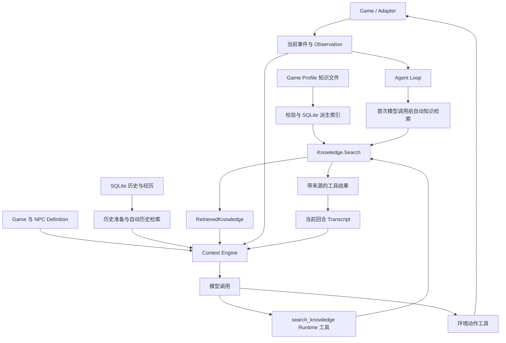

# World Is Agent Phase11.3 知识检索与上下文技术方案

日期：2026-10-19（Asia/Shanghai）

状态：源码已实现知识库、自动知识召回、`search_knowledge` 与 Stardew 背景迁移。验证范围与实际结论见[验收记录](phase11.3-acceptance.md)，配置与升级见[测试指南](../development/testing.md#knowledge-retrieval)。

适用项目：`world-is-agent`。实现基线：`f4f212a`。首个内容接入为 Stardew Valley；Runtime 检索与上下文实现保持跨游戏通用。

## 1. 目标与交付边界

NPC 在首次回答前获得相关背景，在后续推理中能够主动查询更具体的资料；人物身份、核心规则、当前事实和共同经历持续保持明确来源。

本工作单元包括：

- 游戏知识内容、校验与派生检索索引。
- 模型首次调用前的自动知识检索。
- Runtime 只读工具 `search_knowledge`，与自动检索共用搜索服务。
- `RetrievedKnowledge` 上下文区块、预算、来源与诊断。
- Stardew Game Definition 的内容精简与知识条目迁移。
- 配置装配、发布资源、直接回归与可复现验收材料。

现有 Memory、RecentExperiences、Task、账号和 Adapter 协议保持各自职责。本方案不增加知识管理网页、网络抓取、模型写知识、向量数据库、知识图谱、主动任务生成或通用剧情条件引擎。NPC Definition 保留现有人设和声音，不开展全量人设改写。

## 2. 当前实现基线

| 部分 | 当前能力 | 11.3 接入点 |
| --- | --- | --- |
| Game / NPC Definition | JSON 静态模板；每轮投影当前游戏与当前角色 | 保留必需信息，迁移详细公共背景 |
| 持久化历史 | SQLite 原始来源、摘要检查点和来源覆盖关系 | 保持数据与读写语义 |
| 历史自动召回 | 首次模型调用前按本轮 ContextFacts 进行有界关键词检索 | 与知识检索分别执行、分别投影 |
| RecentExperiences | 可信经历独立持久化；关注期内自动进入 Context | 保持关注期、存档归属与预算 |
| Context Engine | 投影、来源过滤、裁剪、估算与最终请求预算检查 | 增加知识输入、渲染与报告 |
| Runtime Tool | Registry 支持 Runtime 工具；生产装配主要围绕 Task | 绑定独立的知识只读范围 |
| Game Profile 生命周期 | 选择游戏、准备资源、排空旧实例后发布新实例 | 同时绑定知识目录与索引生命周期 |

现有历史检索是关键词检索，不包含 embedding 或语义向量库。历史自动召回也不等于已有模型可调用的知识查询工具。

代码入口：

- [历史检索准备](../../runtime/internal/agent/retrieval.go)、[检索配置](../../runtime/internal/agent/retrieval_config.go)。
- [Context 投影与预算](../../runtime/internal/context/context.go)、[历史片段投影](../../runtime/internal/context/retrieval_projection.go)。
- [Runtime 工具注册](../../runtime/internal/tool/registry.go)、[工具上下文](../../runtime/internal/tool/types.go)、[Task 装配](../../runtime/internal/agent/task_context.go)。
- [Definition 加载](../../runtime/internal/definition/loader.go)、[资源发布](../../runtime/config/defaults.go)、[运行实例切换](../../runtime/internal/bootstrap/reconfigure.go)。

## 3. 信息归属与权威

| 信息 | 权威来源与作用域 | 进入 Context 的方式 |
| --- | --- | --- |
| 世界身份、通用事实边界 | Game Definition；`game_id` | 每轮保留核心内容 |
| 人设、稳定身份、表达方式 | NPC Definition；`game_id + definition_id` | 当前角色每轮保留核心内容 |
| 地点、设施、公共关系与玩法背景 | Knowledge Catalog；游戏与内容版本 | 自动召回或工具查询 |
| 当前好感、位置、设施状态与目标进度 | Game，经 Adapter 提供当前 Observation | 当前事实投影 |
| 玩家与 NPC 的对话、动作与结果 | Memory；`game_id + world_id + entity_id` | 摘要、近期来源与历史检索 |
| 已确认的关键交互 | Adapter 经历回执与 SQLite 原始来源 | RecentExperiences 或历史检索 |
| 预约生命周期和完成证据 | Task Store 与游戏回执 | Task Context |
| 玩家显式偏好 | 本地已配置来源或托管账号偏好 | 可选 PlayerPreferences 投影 |

托管模式通过账号独立 Runtime 与持久卷建立 `user_id` 外层隔离，卷内沿用 game/world/entity 范围。知识内容不保存玩家私有经历；同一游戏的静态背景可以共用。

来源冲突按语义处理：当前状态由当前 Observation 决定，过去经历以相应原始记录和回执为依据，静态规则以所加载的内容为依据。摘要是历史的有损投影；玩家陈述、NPC 意图和游戏确认的结果分别保留归属。工具权限始终由 Runtime 与 Adapter 执行校验。

## 4. 目标架构



`Knowledge.Search` 负责可见性过滤、关键词匹配、排序与有界返回。Loop 负责决定自动查询时机和装配工具；Context Engine 只消费检索结果并投影，不直接读知识文件、执行 SQL 或调用模型。

检索在 Runtime 内完成，不经 Adapter 执行，不创建 Action、Task 或游戏副作用。Game / Adapter 继续拥有当前事实和真实动作执行权。

## 5. 知识内容与索引

### 5.1 内容格式

首版每个启用的游戏使用一个 `knowledge/catalog.json`，每条记录对应一个完整主题。既有 `definitions/` 加载器会递归解释其中的 JSON 为角色定义，因此知识目录与它并列。

```text
runtime/config/games/stardew-valley/
    agent.json
    definitions/
        game.json
        npc-robin.json
        ...
    knowledge/
        catalog.json
```

内容契约：

```json
{
  "schema_version": "v1",
  "game_id": "stardew-valley",
  "source_version": "stardew-knowledge-v1",
  "entries": [
    {
      "id": "buildings.coop",
      "title": "鸡舍的一般用途",
      "aliases": ["鸡舍", "coop"],
      "visibility": {"kind": "public"},
      "text": "鸡舍用于饲养鸡等动物，建造与升级由木匠店提供。当前是否能够建造，以及玩家已有建筑和资源，以当前游戏事实为准。"
    }
  ]
}
```

字段规则：

- `game_id` 必须与当前选中的 Game Profile 一致。
- `id` 在目录内唯一、稳定；`source_version` 表示知识内容版本。
- `id`、`title` 最多 128 个 Unicode 字符；每条最多 32 个别名，每个别名最多 128 字符；`source_version` 最多 64 字符。
- `title`、`aliases` 用于中文名、英文名和常用称呼匹配。
- `visibility.kind` 仅支持 `public`、`definitions`。后者必须提供非空 `definition_ids`，且 ID 属于当前 Definition Catalog。
- `text` 是资料，不承载运行指令、玩家私有数据或当前存档结论。
- 每条正文不超过 512 个现有估算 tokens；主题过长时由内容作者拆分，条件与结论放在同一条记录。
- 首版目录上限为 512 条、原始文件 2 MiB。超限或结构错误在加载时明确失败，不截断成半个知识包。

首批内容来自既有 Game Definition 中经核验的公共背景，覆盖公共人物关系、地点与服务、设施用途及已有玩法说明。当前 NPC 的身份、核心亲属关系和语气继续保留在 NPC Definition 中。

### 5.2 索引与版本

使用现有 Go SQLite 驱动，为每个 Runtime 实例建立进程内派生索引。启动时从已校验的知识文件重建，连接由实例持有并在退役时关闭；知识源文件随配置和发布包持久保存。

索引保存条目、可见范围和词项关联，使用普通 SQLite 表，不依赖额外的 FTS5 扩展。它与 Memory、Task、Accounts 数据库分离，不增加这些数据库的迁移。

服务绑定知识内容哈希，派生索引随当前实现重建。单个实例及其回合始终使用同一份不可变内容；自动检索与工具查询使用相同快照。修改磁盘文件在下一次实例加载时生效，不引入文件监听或知识热编辑。

实例切换失败时，从上一实例持有的已校验内容重建原快照，不重新读取可能已被修改的知识源文件。

知识版本不是存档阶段，也不表示每个存档永久冻结某个内容包。重启后使用所加载的配置内容；本方案不增加按存档固定世界设定的机制。

## 6. 共用检索服务

概念接口：

```text
Search(ctx, KnowledgeReadScope, query) -> SearchResult

KnowledgeReadScope:
    当前 AgentSession、definition_id、已绑定的知识快照

SearchResult:
    status、content_hash、source_version、entries、truncated
```

可见范围从服务端绑定的当前角色获得，模型不能通过查询参数选择用户、世界、角色、文件或内容版本。

检索顺序：

1. 在当前知识快照内按 `game_id` 和可见范围过滤。
2. 规范化查询，生成受限词项；采用中文相邻双字、英文词和数字，并匹配作者维护的别名。
3. 按去重后的匹配项计算初始分数：完整别名每项 8 分、标题词项每项 4 分、正文词项每项 1 分；相同分数按稳定条目 ID 排序。英文别名按词边界匹配，中文别名按完整字串匹配。
4. 至少命中一个完整别名、一个标题词项或两个不同正文词项才有候选资格。当前角色名称等只用于身份定位的词项不单独授予资格；弱相关查询允许没有结果。具体排序和反例一起固定为测试，避免只验证正例。
5. 按条数和 token 预算选择完整条目；来源元数据与结果外壳一并计入预算。

分词可以复用现有历史检索的纯文本处理逻辑；仅在确有复用时抽取小型公共函数。知识检索不调用 History Store，不复用历史的 sequence、摘要覆盖和游戏时间模型，也不与历史片段混合排名。

首版不增加模型改写查询、语义重排或向量索引。词项召回的覆盖范围以测试查询集明确记录。

## 7. 两条查询入口

### 7.1 自动检索

取得当前 Observation 后、首次模型调用前执行一次：

- 从本轮 `ContextFacts.text` 提取有界查询；沿用通用事件事实入口，不解析游戏私有 `Observation.state`。
- 当前角色标识用于权限过滤，不把整份角色定义、全部历史或 Observation JSON 拼进查询。
- 没有有效查询时直接跳过。Task 唤醒等缺少玩家输入的回合不构造额外的游戏专用查询规则，模型仍可主动查询。
- 检索候选冻结在本回合内，每步 Context 构建按实际预算投影。
- 自动检索失败记录诊断，继续使用其余有效上下文。没有检索结果不能被解释为对应知识不存在。

自动知识检索独立于 `memory_enabled` 和 `task.enabled`，两者关闭时仍可工作。

### 7.2 `search_knowledge` 工具

模型可在首次资料不足或需要核对相关背景时发起只读查询。输入仅含 `query`：

```json
{
  "type": "object",
  "properties": {
    "query": {"type": "string", "minLength": 1, "maxLength": 256}
  },
  "required": ["query"],
  "additionalProperties": false
}
```

成功结果示例：

```json
{
  "status": "ok",
  "source_version": "stardew-knowledge-v1",
  "content_hash": "<当前知识内容哈希>",
  "entries": [
    {"id": "buildings.coop", "title": "鸡舍的一般用途", "text": "<完整知识正文>"}
  ],
  "truncated": false
}
```

无命中返回 `status: "no_match"` 与空列表；执行失败返回有界的 `status: "unavailable"` 和稳定错误 code。两者分别表达检索结果与服务故障。参数错误沿用现有 JSON Schema 校验和纠正消息机制，未通过校验时不执行搜索。

通用参数校验执行顶层字符串声明的 `minLength`、`maxLength`，按 Unicode 字符计数；本轮不引入完整 JSON Schema 引擎。只有空白或标点而没有有效词项的查询返回无命中。

工具接入要求：

- 注册为同步、只读 Runtime 工具，不绑定环境动作执行器。
- 工具上下文绑定独立 `KnowledgeReadScope`；Task 信息保持可选，Task 权限与原有检查保持原有职责。
- 每步装配先加入知识工具，再按当前有效 Task 权限加入 Task 工具，合并后执行一次准入检查。普通交互回合没有 Task 权限时仅省略 Task 工具；Task 唤醒回合权威失效时仍按既有规则终止回合。
- 知识工具与环境工具同名时，配置明确报错，不静默覆盖。
- 结果通过现有标准工具消息进入 Current Turn Transcript，保留原始调用与对应结果。
- 调整游戏 profile 的工具说明，使模型能够选择信息查询和环境动作；可见回复仍由游戏现有对话能力交付。
- 工具调用共享既有调用次数、步数、取消与超时机制，不建立独立的重试循环。

查询结果可以作为回合记录中的引用资料保存，但不因此变成玩家经历，不生成 RecentExperience，也不授予新的游戏权限。首版不额外增加历史搜索 Tool。

## 8. Context 来源与预算

### 8.1 一次模型请求的组成

| 区块 | 来源 | 进入条件 |
| --- | --- | --- |
| Runtime Policy / Instruction | Runtime 与当前 profile | 每次请求 |
| Agent Descriptor | 当前会话与 canonical target | 每次请求 |
| Game Definition / NPC Definition | 当前选中模板 | 每次请求保留核心内容 |
| Current Event / ContextFacts | 当前事件 | 有当前事件时 |
| Current Observation | Adapter 当前观察 | 每次请求 |
| Task Context | 当前有效 Task 快照与结果 | 存在对应 Task 内容时 |
| PlayerPreferences | 已配置的显式偏好来源 | 可用且预算允许时 |
| History | 持久化摘要＋未被摘要覆盖的近期完整来源 | 启用持久化历史时 |
| Recent Memory | 兼容的近期 Record 投影 | 未使用 History 输入的兼容路径 |
| RecentExperiences | 关注期内、当前存档有效的可信经历 | 有合格事实且预算允许时 |
| RetrievedHistory | 相关历史原始片段 | 历史检索有命中时 |
| RetrievedKnowledge | 当前可见的知识条目 | 自动知识检索有命中时 |
| Current Turn Transcript | 本回合此前步骤的调用、结果与纠正反馈 | 第二步及以后，按实际记录 |
| Tools | 当前准入的工具定义 | 每次请求，与最终预算一起检查 |

Recent Memory 和 History 的近期来源在当前代码中是两条投影路径，并非必须同时注入的两份历史。Current Turn Transcript 只表示本回合早先步骤，不承担跨回合持久记忆。

### 8.2 初始边界

| 项目 | 11.3 设定 |
| --- | --- |
| 自动查询频率 | 每回合首次模型调用前一次 |
| 查询长度 / 词项 | 最多 256 个 Unicode 字符、32 个词项 |
| 单次检索时间 | 最多 500 ms，受剩余回合时间和取消控制 |
| 单次候选扫描 | 最多 512 条可见候选 |
| 自动召回 | 最多 3 条，768 个估算 tokens，包含区块元数据 |
| 单次工具返回 | 最多 3 条，1024 个估算 tokens，包含结果外壳 |
| 新增模型调用 | 自动检索不调用模型；主动查询后的续答计入原有模型步骤 |

首版只暴露 `knowledge.enabled` 配置开关，其余使用集中定义的上述边界，避免增加不必要的配置项。

当前 Stardew profile 为最多 5 步、每步 4 次工具调用、每回合 6 次工具调用、总回合 270 秒、单次 LLM 60 秒；知识查询共享这些限制。原有历史自动召回上限为 5 个片段、1024 个估算 tokens，保持原有配置语义。

预算处理顺序：

1. 按现有规则完成当前事实、核心模板、经历、历史和 Transcript 的投影，并计入新增工具定义。
2. 保持现有历史检索的剩余容量策略，再用可用容量投影自动知识；知识条目不足以完整放入时省略并记录原因。
3. 工具结果受单次返回上限限制，进入 Transcript 后继续受 Transcript 与最终请求预算控制。
4. 模型调用前执行现有完整请求检查；知识不能绕过全局限制，也不为容纳知识主动驱逐已经保留的事实或记忆。

知识区块明确标记为背景资料。资料中的文本不能修改 Runtime Policy、当前身份或工具权限，静态背景不能断言当前存档已完成某项建设。来源 ID、版本和正文一起保留。

## 9. Memory 机制

```text
已完成或失败的回合 / 已确认 Task 结果
    → 持久化原始 History 来源
    → 摘要检查点 + 未覆盖的近期来源
    → 相关问题下检索原始历史片段

游戏确认的关键交互
    → Adapter 可信经历回执
    → SQLite 原始经历 + 索引
    → 关注期内 RecentExperiences
    → 关注期后仍可按话题检索

作者维护的游戏背景
    → Knowledge Catalog
    → 自动知识召回 / search_knowledge
```

长期历史以持久化原始来源为基础，摘要只承担压缩。近期重点经历的选取独立于普通聊天摘要；当前上限为 8 条、768 个估算 tokens。Stardew 成功赠送的初始关注期为三个游戏日，实际可见性由通用经历契约和当前存档有效事实集合约束。

例如“昨天送过蓝莓，今天只打招呼”：只要该赠送仍在关注期、属于当前 NPC 和当前存档且未被容量限制省略，就由 RecentExperiences 进入 Context，不依赖玩家今天再说“蓝莓”。知识检索不会替代或改变这一机制。容量不足时仍会有省略诊断，不承诺无限数量事实每轮全部可见。

历史检索得到的“曾想建鸡舍”和知识检索得到的“鸡舍用途”分别保留来源；当前背包与建设状态继续来自 Observation。

本方案保持普通对话 Memory 的既有限制：它独立于游戏保存检查点，废弃分支的普通历史可能在游戏时间追平后重新可见。近期经历的存档归属过滤与 Task 精确恢复不等于普通聊天已具备完整分支隔离。

## 10. Definition 精简规则

### 10.1 保留与迁移

| 内容 | 目标位置 |
| --- | --- |
| 游戏身份、简短世界概述和必要基本规则 | Game Definition |
| 当前事实、历史、背景的权威边界 | Game Definition / 既有 Runtime Instruction |
| 身份、关系、未知进度与实际执行结果的约束 | 每轮必需内容 |
| 原生目标报告、数量与期限等会影响正确回答的关键约束 | 保留现有必需入口，不依赖知识命中 |
| 地点介绍、设施一般用途、公共人物关系和详细玩法背景 | Knowledge Catalog |
| 当前 NPC 身份、核心家庭关系、性格、声音与拒绝方式 | NPC Definition |
| 当前好感、已解锁设施、原生任务和共同经历 | Observation / Task / Memory |

Game Definition 的 `lore` 字段保持兼容，可以缩短；现有 schema 和字段不删除。每条迁移内容都建立测试映射：原内容主题、目标知识条目与代表性查询。

知识首版只收录公共资料和明确允许当前角色读取的静态内容。私人剧情和阶段专属内容只有具备可信准入依据时才能纳入；本轮不新增任意条件表达式，也不让 Core 根据年份、心数或 Stardew 私有状态推断剧情已开放。公共规则可以用条件式描述，但不能据此宣布玩家满足条件。

### 10.2 发布与兼容

- 新 profile 增加可选的 `"knowledge": {"enabled": true}`；缺省为关闭，旧配置保持有效。
- `knowledge.enabled: true` 时，从当前已解析的 `definition_catalog_root/<game_id>/knowledge/catalog.json` 加载知识；不依赖源码仓库、当前工作目录或隐式兄弟目录。
- 精简的官方 Game Definition 与启用知识的 profile、知识内容作为同一批配置资源交付。仅复制精简定义不构成完整升级。
- 当前资源准备流程优先保留用户已有文件，不会因更新二进制自动覆盖旧的 `agent.json` 或 `game.json`。验收必须分别覆盖全新数据根和保留配置的升级路径；已有用户启用新内容时备份并更新配套文件，不改 Memory 与 Task 数据。
- 内容变更更新相应 `source_version`；运行实例同时绑定实际 Game / NPC Definition 与知识内容，保证回合内版本稳定。
- 启用知识但内容缺失、错误或索引构建失败时，实例加载明确失败，沿用既有配置恢复或切换失败处理；不以缺少资料的精简配置假装 Ready。
- 已启动实例的单次搜索超时属于查询失败，可明确降级回答；知识包加载失败属于配置问题，两者分别处理。
- 旧版本配置和其它游戏维持原有行为。无需修改 Protocol、Adapter 或编译 Mod。

精简收益使用实际估算器记录 Game Definition 与完整模型请求的前后大小。预期降低固定模板成本；不承诺所有话题的总 Token 都减少，相关知识命中和工具续答也有成本。

## 11. 装配、隔离与可观测性

### 11.1 实例与回合

知识源在实例准备阶段完成校验与索引构建，连同 Definition Catalog 和 Loop 一起发布。取消回合、切换游戏、切换模型和关闭实例沿用现有协调流程；旧知识连接随旧实例释放。

自动入口与工具入口共用相同的服务和只读范围。工具的作用域由当前会话与 canonical target 生成，复制进入准入快照；参数不能扩大范围。Task 关闭、Memory 关闭或没有活动 Task 时均可独立查询，且不会生成虚构的 Task Context。

每次检索先做可见性过滤再排序和截取。未知角色定义只可读取 `public` 条目；受限条目不进入返回正文、候选摘要或模型可见的诊断。

### 11.2 诊断

现有 trace 与 ContextBuildReport 增加知识检索状态、内容版本/哈希、入口类型、耗时、保留条目 ID、估算 tokens、截断数和稳定原因码。自动检索完成不代表知识最终进入模型请求，报告以实际保留结果为准。

诊断区分：未启用、无有效查询、无匹配、查询失败、取消和预算省略。不增加独立管理页面；不向模型返回文件绝对路径、SQL、数据库错误堆栈或被拒绝的私有条目信息。

## 12. 实施位置与工作顺序

| 工作 | 主要位置 | 完成条件 |
| --- | --- | --- |
| 知识模型、校验、索引与搜索 | 新增 `runtime/internal/knowledge/` | 通用假游戏、中文查询、可见性与边界验证 |
| 配置与生命周期 | `agent/config.go`、`runtime/config/`、`bootstrap/`；核对 server / worker 装配入口 | 新旧配置、独立数据根、启停与切换有效 |
| 自动召回与 Context | `agent/loop.go`、新增知识准备逻辑、`context/` | Provider 实际请求含正确区块，预算有效 |
| 主动查询工具 | `tool/`、每步工具装配、游戏 profile 工具说明 | 无 Task 时可查、标准工具结果续答、参数纠错有效 |
| 内容迁移 | Stardew `knowledge/catalog.json`、`definitions/game.json` | 每个迁移主题可查，核心规则与角色声音保留 |
| 回归与交付材料 | 相关测试、发布资源校验与验收文档 | 机制、真实模型和实机结论分别记录 |

按以下顺序连续开发：

1. 完成内容契约和共用检索服务，先使用独立测试数据。
2. 接入实例生命周期与自动知识投影，保留完整 Game Definition 验证链路。
3. 接入 `search_knowledge` 与通用只读范围，覆盖 Task / Memory 关闭的场景。
4. 迁移详细背景并精简 Game Definition，完成主题映射与实际请求对比。
5. 执行直接回归、内部 CR、文档检查与独立数据根的集成验收。

每个工作单元完成相关测试和内部 CR 后继续，不要求逐条等待人工批准。若必须扩大到协议、Adapter 进度授权、既有数据迁移或新增产品页面，先确认扩展范围。代码提交仅在用户明确授权时执行，本方案不包含 push。

## 13. 验收矩阵

| 场景 | 通过条件 |
| --- | --- |
| 自动召回 | 首次模型调用前已检索；捕获的 Provider 请求包含对应知识 ID、版本和正文 |
| 主动补查 | 模型调用 `search_knowledge` 后，标准工具结果进入下一次实际请求，并可接续环境对话 |
| 双入口一致 | 相同作用域、查询与快照得到相同候选及排序；展示预算差异有明确截断信息 |
| 没有 Task / Memory | 关闭两者仍能查询知识；不会开放 Task 工具或注入不存在的 Task |
| 角色可见性 | 其他定义无法读取受限条目；自动与工具入口采用相同规则 |
| 跨游戏与实例 | 两种假游戏、并存测试实例与切换后的请求无知识串用；无 Stardew 私有字段分支 |
| 弱查询与失败 | 无效或弱相关查询不强行返回资料；无命中与故障明确区分 |
| 参数与调用限制 | 非对象 JSON、空查询、超长查询、额外字段按现有机制拒绝并可纠正；调用预算与取消有效 |
| 资料中的指令文本 | 资料保持数据边界，不能改变工具准入或通过查询参数读取路径；真实模型行为另行测量 |
| 当前事实优先 | 知识介绍设施用途，当前观察显示尚不可用时，回复不宣称已经解锁；未知时不推断 |
| 近期关键经历 | 昨日赠送后今日问候、大量聊天、摘要和重启场景继续保留合格经历 |
| 旧历史与回档 | 原有摘要、历史检索、经历归属过滤和 Task 恢复测试通过，普通聊天分支限制如实保留 |
| 预算 | 自动知识、工具 schema 和工具结果计入最终请求；容量不足有诊断，调用不超预算 |
| 内容迁移 | 每个移出的背景主题有目标条目与命中样例；核心身份、规则和执行约束仍常驻 |
| 发布与升级 | 全新数据根、既有配置、缺少知识文件、错误版本/格式和无知识的其它游戏行为明确 |
| 生命周期 | 重启重建索引、切换取消旧回合、关闭释放连接；回合内知识版本稳定 |

检索查询集至少包括每个迁移主题的直接称呼、已有别名或常见中文问法，并加入无关问候、错误角色与禁止访问的反例。记录预期命中、实际命中和可见性结论；词项检索未覆盖的同义表达作为明确限制，不以扩大无关召回掩盖。

机制验收以通用 fake、真实 SQLite 与捕获的 Provider 请求为依据。真实模型另检查人物辨识、知识使用、事实冲突、合理补查及可见回复；这些结果不能由 fake 模型推断。

实机复核步骤：在测试存档向罗宾询问设施用途，再询问当前进度相关问题；完成一次原生赠送，跨日后问候；重启 Runtime 后继续交谈。核对背景回答、当前状态和共同经历各自有正确来源。查询失败时 NPC 可以说明不确定或保留判断，原生游戏交互保持可用，查询不改变物品、好感和任务。没有实机证据时，验收记录只认定已执行的后台与模型范围。

## 14. 交付依据与已知限制

交付包含可检索的 Stardew 背景内容、精简 Game Definition、两个查询入口、实际 Context 请求证据、直接回归结果与独立验收记录。达到已验证的对外能力时，再更新公开事实源；方案存在不表示功能已实现。

首版能力边界：关键词召回不保证所有改写均命中；静态知识不保证当前存档满足条件；知识本身不增加 NPC 感知或游戏动作；普通聊天仍保留既有回档分支限制。知识查询、记忆可靠性和角色实际回答质量分别验收。

相关基线：[角色与世界内容](npc-and-world-definitions-plan.md)、[11.15 体验方案](phase11.15-npc-experience-and-contextual-objectives.md)、[近期经历执行方案](recent-experiences-execution.md)、[近期经历验收](recent-experiences-acceptance.md)、[托管 Runtime 方案](phase11.2-hosted-runtime-and-launch.md)。
